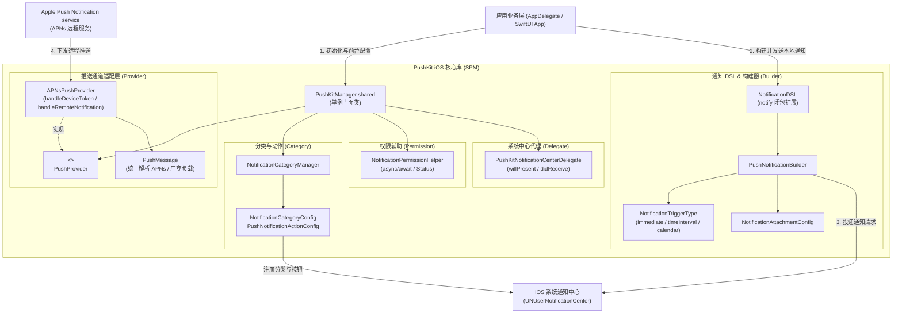

# PushKit - iOS (Swift) 通知与 APNs 远程推送封装库

`PushKit` (iOS) 是一套轻量、现代、优雅的 iOS 通知与推送封装库，全面基于 Swift 5.9+ 并适配 iOS 15.0+ 与 macOS 11.0+。通过极简的 **Swift DSL**、对齐 Android `NotificationChannel` 哲学的 **交互式通知分类 (`NotificationCategoryManager`)**、**权限异步辅助 (`NotificationPermissionHelper`)**、**前台 Banner / 点击代理分发 (`PushKitNotificationCenterDelegate`)** 以及 **官方 APNs 远程推送通道 (`APNsPushProvider`)**，大幅降低 iOS 通知开发门槛。

---

## 🌟 核心特性

- 🚀 **Swift 声明式 DSL**：通过 `PushKitManager.shared.notify { ... }` 极简闭包快速装配富文本、声音、自定义数据与触发器。
- 📢 **交互式通知分类治理 (`NotificationCategoryManager`)**：快捷注册 `NotificationCategoryConfig` 与动作按钮，长按即可弹出操作菜单（如 [回复]、[稍后提醒]）。
- 🛡️ **异步权限管理 (`NotificationPermissionHelper`)**：全面基于 Swift Concurrency (`async/await`) 检查与请求系统通知权限，支持直跳系统应用设置。
- 🔔 **前台横幅与点击托管 (`PushKitNotificationCenterDelegate`)**：开箱即用支持前台直接弹出横幅展示通知（`.banner, .sound, .badge, .list`）与点击跳转回调。
- 🔌 **官方 APNs 原生集成 (`APNsPushProvider`)**：自动注册 Apple 远程通知、转换 DeviceToken Hex 字符串，并将原始 APNs 字典统一解析为 `PushMessage`。
- 📦 **Swift Package Manager (SPM) 原生集成**：无需第三方依赖管理器，Xcode 原生一键接入。
- 📱 **配套精美 SwiftUI Demo App**：附带完整的 `Example/PushKitDemo.xcodeproj` 演示工程，可直接运行在模拟器或真机体验。

---

## 🛠️ 项目结构

```
PushKit-iOS/
├── Package.swift                             # SPM 依赖与模块定义
├── Sources/PushKit/                          # 核心库源码
│   ├── PushKitManager.swift                  # 统一门面单例类
│   ├── Permission/
│   │   └── NotificationPermissionHelper.swift # async/await 权限请求与设置直跳
│   ├── Category/
│   │   └── NotificationCategoryConfig.swift   # 交互式通知分类与快捷动作按钮
│   ├── Builder/
│   │   ├── PushNotificationBuilder.swift     # 链式构建器与三种触发器封装
│   │   └── NotificationDSL.swift             # 声明式 DSL 语法糖扩展
│   ├── Delegate/
│   │   └── PushKitNotificationCenterDelegate.swift # 前台展示与交互点击代理
│   └── Provider/
│       ├── PushMessage.swift                 # 统一跨端推送消息模型
│       ├── PushProvider.swift                # 厂商推送协议
│       └── APNsPushProvider.swift            # 官方 APNs 原生远程推送通道
├── Tests/PushKitTests/
│   └── PushKitTests.swift                    # 单元测试套件
└── Example/                                  # 配套 SwiftUI 交互式演示工程
    ├── PushKitDemo.xcodeproj                 # Xcode 项目工程文件
    └── PushKitDemo/                          # Demo 界面与启动入口
```

---

## 📐 代码架构图解



---

## 🚀 第三方快速接入指南

### 1. 依赖配置 (Swift Package Manager)

#### 方式 A：Xcode 图形化添加
1. 在 Xcode 中打开你的主项目，选择菜单 **File > Add Package Dependencies...**
2. 在搜索框中输入仓库地址：
   ```
   https://github.com/e-hai/PushKit-iOS.git
   ```
3. Dependency Rule 选择 **Exact Version** 并输入 `1.0.0`（或选择 Up to Next Major）。

#### 方式 B：在 `Package.swift` 中引入
```swift
dependencies: [
    .package(url: "https://github.com/e-hai/PushKit-iOS.git", exact: "1.0.0")
]
```

---

### 2. 初始化与前台通知横幅展示

在 `AppDelegate` 或 `@main App` 的 `init()` 中进行设置：

```swift
import UIKit
import PushKit

@main
class AppDelegate: UIResponder, UIApplicationDelegate {
    func application(
        _ application: UIApplication,
        didFinishLaunchingWithOptions launchOptions: [UIApplication.LaunchOptionsKey: Any]? = nil
    ) -> Bool {
        // 1. 初始化 PushKit，绑定 UNUserNotificationCenterDelegate
        PushKitManager.shared.setup()
        
        // 2. 自定义前台通知横幅展示选项（默认支持 banner, list, sound, badge）
        PushKitManager.shared.delegate.willPresentNotificationHandler = { notification in
            return [.banner, .sound, .badge, .list]
        }
        
        // 3. 监听用户点击通知行为（可选）
        PushKitManager.shared.delegate.didReceiveNotificationResponseHandler = { response in
            let userInfo = response.notification.request.content.userInfo
            print("用户点击了通知：\(userInfo)")
        }
        
        return true
    }
}
```

---

### 3. 请求系统通知权限

```swift
// 异步请求通知权限
Task {
    do {
        let granted = try await PushKitManager.shared.requestPermission(options: [.alert, .badge, .sound])
        print("通知授权状态：\(granted)")
    } catch {
        print("权限申请失败：\(error)")
    }
}

// 引导用户跳转到系统设置中的本应用通知设置页
PushKitManager.shared.openNotificationSettings()
```

---

### 4. 发送通知 (使用 Swift DSL)

#### 发送普通即时通知
```swift
Task {
    try? await PushKitManager.shared.notify(id: "msg_1001") { builder in
        builder.title = "新订单通知"
        builder.subtitle = "外卖配送中"
        builder.body = "骑手已接单，预计 20 分钟内送达。"
        builder.badge = 1
        builder.userInfo = ["order_id": "123456"]
    }
}
```

#### 发送倒计时定时通知 (`timeInterval`)
```swift
Task {
    try? await PushKitManager.shared.notify(id: "reminder_1002") { builder in
        builder.title = "⏰ 定时提醒"
        builder.body = "5 秒倒计时结束，提醒事项到达！"
        builder.triggerType = .timeInterval(seconds: 5, repeats: false)
    }
}
```

#### 发送富媒体图片通知 (`Attachment`)
```swift
if let imageURL = Bundle.main.url(forResource: "banner", withExtension: "jpg") {
    Task {
        try? await PushKitManager.shared.notify(id: "image_1003") { builder in
            builder.title = "图文并茂的通知"
            builder.body = "长按或下拉通知栏可直接展开查看图片。"
            builder.addAttachment(fileURL: imageURL)
        }
    }
}
```

---

### 5. 接入官方 APNs 远程推送

```swift
// 1. 在 AppDelegate 中接收系统返回的二进制 DeviceToken 并转发给 PushKit
func application(_ application: UIApplication, didRegisterForRemoteNotificationsWithDeviceToken deviceToken: Data) {
    PushKitManager.shared.apnsProvider.handleDeviceToken(deviceToken)
}

// 2. 接收 APNs 远程推送并自动解析为统一数据结构 PushMessage
PushKitManager.shared.apnsProvider.setMessageListener { message, providerName in
    print("收到来自 [\(providerName)] 的远程推送：title=\(message.title ?? ""), body=\(message.body ?? "")")
    print("自定义业务负载：\(message.payload)")
}

// 3. 向 APNs 服务器注册请求设备 Token
PushKitManager.shared.apnsProvider.register { token, provider in
    print("成功获取 APNs DeviceToken: \(token)")
    // 上报 token 给你的业务后台
}
```

---

## 📱 运行 Demo 示例工程

仓库内附带完整的 **SwiftUI 交互式 Demo App**：

1. 双击打开 `Example/PushKitDemo.xcodeproj`。
2. 在 Xcode 顶部选择任一 **iPhone 模拟器**（如 iPhone 16 / 15）。
3. 按下快捷键 `Cmd + R` 启动体验即可！

---

## ⚙️ 编译与测试

```bash
# 编译库模块
swift build

# 运行完整单元测试
swift test
```

---

## 📄 License

本项目采用 MIT 许可证，详情参见 LICENSE 文件。
